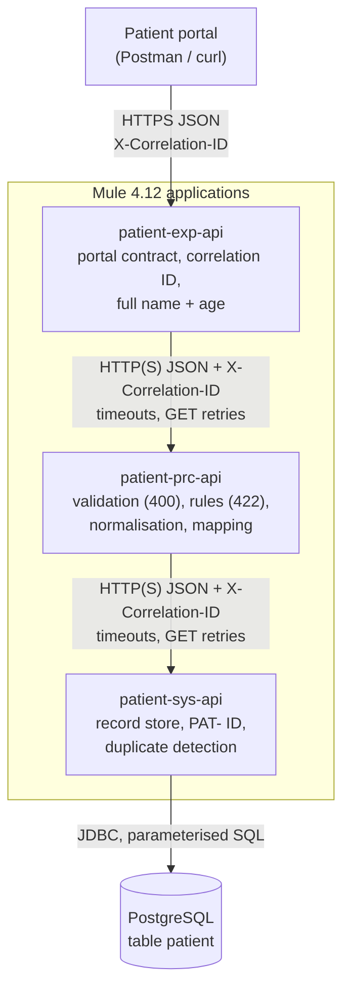
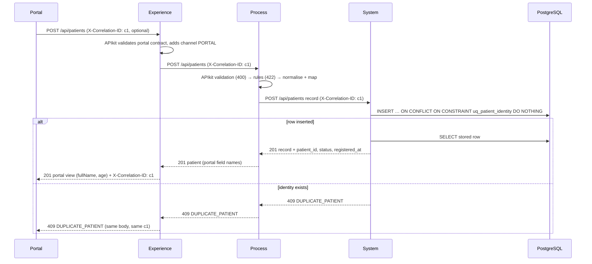

# Acme Clinic: Patient Registration APIs (MuleSoft)

Three Mule 4 applications, API-led, that take a registration from the patient portal,
validate it, normalise it, store it in PostgreSQL and read it back.

| Application | Layer | Responsibility | Local port |
|---|---|---|---|
| [`patient-exp-api`](patient-exp-api) | Experience | Portal contract. Accepts or creates the correlation ID, adds `channel: PORTAL`, shapes responses (full name, age). | 8081 |
| [`patient-prc-api`](patient-prc-api) | Process | Validation, business rules, normalisation, mapping portal fields ⇄ record format. | 8082 |
| [`patient-sys-api`](patient-sys-api) | System | The only layer with database access. Stores/reads records, generates the patient ID. No business rules. | 8083 |

The three apps build with 107 MUnit tests at 100% coverage in each app, and the nine
sample cases pass end to end against PostgreSQL. GitHub Actions builds and tests every
push and deploys `main` to CloudHub 2.0 ([docs/deployment.md](docs/deployment.md)).

| Application | CloudHub 2.0 URL (Sandbox, US East 2) |
|---|---|
| patient-exp-api | https://patient-exp-api-id14xw.5sc6y6-4.usa-e2.cloudhub.io |
| patient-prc-api | https://patient-prc-api-id14xw.5sc6y6-4.usa-e2.cloudhub.io |
| patient-sys-api | https://patient-sys-api-id14xw.5sc6y6-4.usa-e2.cloudhub.io |

The portal entry point is the Experience API, e.g.
`GET https://patient-exp-api-id14xw.5sc6y6-4.usa-e2.cloudhub.io/api/patients/PAT-000001`.

**Bonus items:** search by last name, `Idempotency-Key` (Object Store), DataWeave
modules with their own tests, the coverage gate, structured JSON logging, and Client ID
Enforcement on the Process and System APIs ([docs/api-manager.md](docs/api-manager.md)).

---

## Architecture



Each API calls only the layer directly below it. Only the System API has a database
connector; the other two have no database dependency at all.

**Why API-led here.** The portal format, the business rules and the record format change
for different reasons and at different speeds. A second channel (kiosk, call centre)
would reuse the Process API with its own `channel` and never see the database. A
database change stays behind the System API's record contract. The cost is two extra
network hops and duplicated error-handling plumbing. The plumbing is kept identical
across apps (same files, same error catalogue) so it can later move into a shared
Exchange library.

### One registration end to end



### Repository layout

```text
patient-exp-api/  patient-prc-api/  patient-sys-api/   one Mule app each (Studio layout)
  src/main/mule/         <app>.xml (APIkit main + operation flows), global.xml,
                         error-handler.xml, request-context.xml, <lower>-client.xml
  src/main/resources/    api/ (RAML + types library + examples), dwl/ (DataWeave modules),
                         config/ (common + per-environment properties), log4j2.xml
  src/test/munit/        API-level suite + DataWeave module suite
db/                      schema.sql, grants.sql, tests/constraint-tests.sql
infrastructure/          docker-compose.yml (PostgreSQL 16), init script, .env.example
postman/                 collection (9 sample cases + 4 bonus requests) + local / CloudHub environments
scripts/                 local run, E2E, failure modes, secrets tooling, DB reset
.github/workflows/       ci-cd.yml (build+test on push/PR, deploy from main)
docs/                    deployment.md, api-manager.md
pom.xml                  build aggregator only (not a parent): `mvn clean verify` for all
```

## Contracts

Every API has its own RAML 1.0 spec (`src/main/resources/api`) with a types library,
examples and a shared `correlated` trait, implemented with APIkit. All three expose
`POST /api/patients` (201 + `Location`) and `GET /api/patients/{patientId}` (200), where
`patientId` must match `^PAT-[0-9]{6}$`.

| Layer | Request | Response |
|---|---|---|
| Experience | portal registration (no `channel`) | `patientId, fullName, age, category, email, phone?, status, registeredAt` |
| Process | portal registration + `channel` | portal field names, nested `contact` / `consents`, `category`, `status`, `registeredAt` |
| System | record (`given_name`, `family_name`, `birth_date`, `sex`, `category`, `email`, `phone?`, `consent_*`, `source`) | record + `patient_id`, `status`, `registered_at` |

The Experience and Process specs both validate the portal shape (required fields,
`yyyy-MM-dd`, `gender` enum, non-blank names, email/phone shape). The Experience spec is
the portal contract. The Process spec is required by the assignment, and it also
protects the Process API from other channels. **Business rules are only in the Process
API.**

### Search by last name (bonus)

`GET /api/patients?lastName={lastName}` runs through all three layers. Each layer keeps
its own responsibility:

| Layer | Query | Does | Returns |
|---|---|---|---|
| Experience | `lastName` (required, non-blank) | forwards the term unchanged | array of portal views (age today) |
| Process | `lastName` | normalises it **like a registered last name** (trim, first letter upper, rest lower) | array of patients in portal field names |
| System | `family_name` | exact match on the stored value, `ORDER BY patient_id LIMIT 100`, index `ix_patient_family_name` | array of records |

- Because the stored names are normalised the same way, `KOVAČ` or ` kovač ` finds `Kovač`.
- No match is `200 []`, not 404.
- The search is a GET, so it gets the same timeouts and retries as the read by ID.
- The search term is a patient name, so it is never logged. The logged downstream path
  leaves out the query string, and `request.received` logs the path without it.
- The 100-row cap is a fixed guard; there is no paging.

## DataWeave: mapping and normalisation

Mappings live in `.dwl` modules (`src/main/resources/dwl`), each with its own MUnit
tests, rather than inline in transforms:

| Module | Content |
|---|---|
| `prc: PatientMapping` | `toRecord` / `toPatient` (both directions), `normaliseName`, `normaliseEmail`, `normalisePhone`, gender ⇄ sex |
| `prc: RegistrationRules` | `isBornInFuture`, `hasDataProcessingConsent`, `ageOn`, `categoryFor`, `todayIn` |
| `exp: PortalView` | `toProcessRegistration` (adds `channel`), `toPortalPatient` (fullName, age) |
| `sys: PatientRecords` | row ⇄ record formatting and insert parameters (no rules) |
| all: `ApiErrors`, `Downstream` | error catalogue; interpretation of lower-API responses |

Decisions worth knowing:

- **Names**: trim, then first letter upper case and the rest lower case, exactly as
  specified: `" ana "→"Ana"`, `"KOVAČ"→"Kovač"`, `"đorđe"→"Đorđe"`. The trim also
  removes Unicode separators (no-break space), which `String.trim()` would keep.
  Applying the rule literally turns `"ana-marija"` into `"Ana-marija"`.
- **Phone**: spaces, dashes and brackets are removed. An absent, `null` or blank phone
  leaves the field **out** of the record, not `null`.
- **Age and category** use completed years on a calendar date. There is no
  milliseconds-per-year approximation. A birthday counts once its month and day are
  reached, so 29 February birthdays age on 1 March in non-leap years (same as
  `java.time.Period`). "Today" is the date in the clinic's time zone
  (`clinic.timeZone`, `Europe/Sarajevo`), so a registration just after local midnight
  isn't judged by UTC's date.
- **Category is stored at registration**, as the record format requires. GET returns the
  stored value, so a MINOR stays MINOR in the record after turning 18, while the
  Experience API's `age` is always current.
- **Dates from the database** are formatted in SQL (`birth_date`) or read as epoch
  seconds (`registered_at`). No JDBC `Date`/`Timestamp` passes through the JVM time zone,
  the classic off-by-one-day bug.

## Business rules and validation

| Check | Where | Result |
|---|---|---|
| Shape, required fields, `yyyy-MM-dd`, gender enum | APIkit (Experience and Process spec) | 400 `BAD_REQUEST` |
| Date of birth after today (clinic date) | Process, before any lower call | 422 `INVALID_BIRTH_DATE` |
| `consents.dataProcessing` not `true` | Process, before any lower call | 422 `CONSENT_REQUIRED` |
| Same normalised name + birth date | database constraint, via System API | 409 `DUPLICATE_PATIENT` |

## Database

`db/schema.sql` is idempotent and never drops data. It defines one table, `patient`,
with a column per record field. `patient_id` defaults to `'PAT-' || lpad(nextval(...), 6, '0')`
from a sequence capped at 999999, so it can't silently grow a seventh digit.
`status` defaults to `ACTIVE`, `registered_at` is `timestamptz DEFAULT now()`, `phone`
is nullable, and CHECK constraints cover the closed code lists and the ID format.

**Duplicates.** The unique constraint `uq_patient_identity (given_name, family_name, birth_date)`
is the duplicate check. The insert is
`INSERT … ON CONFLICT ON CONSTRAINT uq_patient_identity DO NOTHING`: when the constraint
rejects the row, zero rows are affected and the System API raises
`APP:DUPLICATE_PATIENT` → 409. I chose this over catching the exception because:
- it names exactly one constraint, so no other SQL failure can be mistaken for a duplicate;
- it does not depend on driver messages or SQLSTATE parsing;
- it is race-free under concurrent registrations.

Because names are normalised before storing, case 4 (`"ANA kovač"`) collides with case 1.

All SQL is static text with named parameters; nothing is concatenated. The runtime role
`patient_app` can only `SELECT` and `INSERT`. Credentials are AES-encrypted Secure
Configuration Properties, and the key is supplied at runtime (`-Dsecure.key`, a CloudHub
secure property). The local secure file is generated and git-ignored; the CloudHub one
holds ciphertext only.

## Error handling

One error handler per app (`error-handler.xml`), registered as the default via
`<configuration defaultErrorHandler-ref>`. No flow has a copy. It maps the Mule error
type to a code through `dwl/ApiErrors.dwl`, which is the same file in all three apps,
and returns the same body everywhere:

```json
{ "error": { "code": "DUPLICATE_PATIENT", "message": "A patient with the same name and date of birth already exists.",
             "correlationId": "6f1c2a9e-0b7d-4c1e-9a52-3c4d5e6f7a8b", "timestamp": "2026-10-15T10:21:07Z" } }
```

| Status | Code | Raised by |
|---|---|---|
| 400 | `BAD_REQUEST` | `APIKIT:BAD_REQUEST`, lower-API 400 |
| 404 | `PATIENT_NOT_FOUND` | System API (no row), lower-API 404 with that code |
| 409 | `DUPLICATE_PATIENT` | System API (constraint), lower-API 409 |
| 422 | `INVALID_BIRTH_DATE`, `CONSENT_REQUIRED` | Process API rules, lower-API 422 |
| 502 | `DOWNSTREAM_ERROR` | connection error / timeout / 503 after retries, unexpected lower status, database unreachable |
| 500 | `INTERNAL_ERROR` | anything else |

Protocol errors that APIkit detects keep their HTTP meaning, using codes beyond the
table: 404 `RESOURCE_NOT_FOUND` (unknown path), 405 `METHOD_NOT_ALLOWED`,
406 `NOT_ACCEPTABLE` and 415 `UNSUPPORTED_MEDIA_TYPE`.

**Status codes survive the trip up.** Each client sub-flow (`<lower>-client.xml`) accepts
every HTTP status from the lower API and classifies it with `dwl/Downstream.dwl`. A
400/404/409/422 whose body carries one of the shared codes is re-raised as the same
typed `APP:` error, so the caller gets the same status and code. Anything else is a
`DOWNSTREAM_ERROR`. That includes a 404 without a `PATIENT_NOT_FOUND` body (e.g. a
wrong base path), a 5xx, or an HTML page from a load balancer.

**No internals in responses.** Messages are fixed strings from the catalogue. Exception
text, SQL, host names and connector messages never reach a body. MUnit asserts this
for SQL failures; the live failure-mode script asserts it for an outage.

## Reliability

- **Timeouts**: every lower-API request has an explicit `responseTimeout` and a TCP
  `connectionTimeout`. Values are budgeted so an upstream timeout never fires while the
  layer below is still retrying: Process → System 5 s, Experience → Process 20 s, which
  is more than the Process worst case of 3 × 5 s + 2 × 0.5 s. Database statements have
  a 10 s query timeout, and pgjdbc connect/socket timeouts are set in the URL.
- **GET retries, transient failures only.** The GET sits in `until-successful`
  (`maxRetries=2`, so at most 3 attempts, 500 ms apart). Its response validator makes
  **503 the only status that raises an error**. Inside the scope, therefore, the only
  possible errors are `HTTP:CONNECTIVITY`, `HTTP:TIMEOUT` and `HTTP:SERVICE_UNAVAILABLE`.
  A 4xx can't trigger a retry by construction. After the last attempt,
  `MULE:RETRY_EXHAUSTED` → 502.
- **No retry amplification**: when the Process API runs out of retries it answers 502,
  not 503, so the Experience API doesn't retry it again: with the System API down, the
  Process API makes 3 attempts and the Experience API 1.
- **POST is never retried: a registration may already be committed when only the
  response is lost, so retrying could turn a successful registration into a 409 for the
  patient's own data, or into a double registration if the lower layer were not
  idempotent.**

### Idempotency-Key on the Experience POST (bonus)

The **caller** can make its POST safe to retry. It sends an optional
`Idempotency-Key` header (1-64 characters `A-Z a-z 0-9 . _ : -`; a UUID is recommended).
A repeat with the same key and body returns the **original response** (status, body,
`Location`) without registering again. The repeat carries `Idempotent-Replayed: true`
and its own `X-Correlation-ID`. Implementation: `patient-exp-api/src/main/mule/idempotency.xml`
and `dwl/Idempotency.dwl`.

| Situation | Answer |
|---|---|
| New key | processed. A `201` is stored for 24 h (`idempotency.ttlHours`). |
| Same key, same body, completed | the stored 201 is replayed. The Process API is not called. |
| Same key, same body, first request still running | `409 IDEMPOTENCY_KEY_IN_PROGRESS` |
| Same key, different body | `422 IDEMPOTENCY_KEY_MISMATCH`. The key is bound to a SHA-256 fingerprint of the canonical JSON body (key order does not matter). |
| First request failed (4xx/5xx) | the key is released, so a retry is processed again. Only a 201 is remembered. |
| `IN_PROGRESS` older than 60 s (`idempotency.inProgressTimeoutSeconds`, more than the 20 s POST timeout) | treated as abandoned, e.g. the runtime stopped mid-request. The next request claims the key. |

- **Atomic claim.** The key is claimed with `os:store failIfPresent="true"` (an
  `IN_PROGRESS` entry), so of two concurrent requests with one key only one proceeds.
- **Persistent store.** It is a persistent Object Store. On CloudHub 2.0 that is
  **Object Store v2** (`<integrations><services><objectStoreV2>` in the deployment
  profile), shared by replicas and kept across restarts.
- **Personal data in the store.** The stored body is the portal view, which is personal
  data: it lives in the store for at most 24 h. The key and the body are never logged.
- **Limit.** A request whose response is lost after the Process API committed, and which
  then fails in the Experience API itself, is released. Its retry gets
  `409 DUPLICATE_PATIENT`. End-to-end exactly-once would need the key to reach the
  System API.

- The Experience API takes `X-Correlation-ID` from the caller. When the header is
  missing, the event's correlation ID is used, generated as a UUID
  (`correlationIdGeneratorExpression="#[uuid()]"`). The value is stored in
  `vars.correlationId`.
- Each lower call sends it **explicitly** as `X-Correlation-ID` (`sendCorrelationId="NEVER"`
  plus an explicit header), and Process/System adopt it the same way. Every response
  returns it in the header, and every error body contains it.
- Every log line contains it: the log4j2 layout prints `%X{correlationId}`, which Mule
  sets per event. The HTTP listener adopts an incoming `X-Correlation-ID` as the event's
  correlation ID. MUnit asserts that `correlationId == vars.correlationId` in all three
  apps, so the logged value and the propagated value are provably the same.
- **Structured JSON logging.** Each line is one JSON object (`timestamp`, `level`,
  `logger`, `thread`, `app`, `correlationId`, `message`, and `exception` when there is
  one), written by a log4j2 `PatternLayout` with `%enc{…}{JSON}` escaping. That needs no
  extra library and behaves the same on every Mule 4 runtime. Application messages are
  JSON events themselves, built by `dwl/LogEvent.dwl`:
  ```json
  {"timestamp":"2026-10-19T19:47:10.460+02:00","level":"INFO","logger":"com.acme.patient.prc","thread":"…","app":"patient-prc-api","correlationId":"ab7d6be4-…","message":"{\"event\": \"downstream.response\",\"correlationId\": \"ab7d6be4-…\",\"target\": \"system-api\",\"status\": 201,\"durationMs\": 65}"}
  ```
  The message is structured, not just the layout, because CloudHub 2.0 removes file
  appenders and collects logs with its own appender. The message is what reaches
  Runtime Manager unchanged, so the event fields and the correlation ID survive there.
- Events per request: `request.received` (method, path), `downstream.request` (target,
  method, path), `downstream.response` (target, status, durationMs), `response.sent`
  (status, durationMs, and on errors `code` plus the Mule `errorType`; WARN for 4xx,
  ERROR for 5xx). The System API also logs `patient.stored` (patientId).
  `node scripts/log-events.js check <log>` validates a log file and
  `… count <log> <correlationId> <event> [field=value]` queries it; the E2E scripts use both.
- **No patient data in logs.** No payloads or fields are logged, only patient IDs.
  Exception logging is off in the error handler (`logException="false"`), because
  driver messages quote the rejected values: PostgreSQL's
  `Key (given_name, family_name, birth_date)=(Ana, Kovač, 1985-04-12)`. c3p0's INFO
  line that prints the JDBC URL and DB user is silenced. `scripts/e2e-local.sh` scans
  all three logs for the sample patients' data after a run (0 matches).

## Security

- Secrets: DB credentials in encrypted secure properties. The key comes from a system
  property or a CloudHub secure property. Connected App credentials and the key are
  GitHub Secrets. `.env`, `secure-local.yaml` and the CI `settings.xml` are git-ignored.
- `scripts/encrypt-property.sh` produces exactly the ciphertext of the Secure Properties
  module (AES/CBC).
- Least privilege: `patient_app` has SELECT/INSERT only, and only the System API
  receives `secure.key`.
- TLS: CloudHub terminates HTTPS. Lower APIs are called over HTTPS on CloudHub, and the
  hosted DB URL uses `sslmode=require`.

### Client ID Enforcement on Process and System (bonus)

The policy itself is applied in API Manager; the setup steps are in
[docs/api-manager.md](docs/api-manager.md).
- **Pairing.** The Process and System APIs pair with their API Manager instances through
  `<api-gateway:autodiscovery apiId="${api.id}">`.
- **Callers send credentials.** Each caller sends its client application's `client_id`
  / `client_secret` headers (`Downstream::clientCredentialHeaders`), only when they are
  configured. Their sources: deployment properties, the secret a **secure** one, from
  GitHub Secrets.
- **Tested.** An MUnit stub lower API answers 200 only with the expected credentials. The
  test fails with a wrong secret.
- **Gatekeeper.** Without an API Manager instance, the
  default (FLEXIBLE) gatekeeper blocks a paired API with **503**:
  `API ApiKey{id='0'} is blocked`. So:
  - local runs disable it;
  - CloudHub deployments disable it while `SYS_API_ID` / `PRC_API_ID` are empty, and
    keep it on once the IDs are set.

  Deploying without API Manager therefore works as before.
- **Policy 401s.** A 401 from a policy means the caller's own credentials are wrong, so it
  surfaces as 502 `DOWNSTREAM_ERROR` and is not retried.

## Running locally

Prerequisites: Java 17, Maven 3.9.x (built with 3.9.15), Docker, a Mule 4.9+ EE
standalone runtime (tested with 4.12.3; Anypoint Code Builder installs one under
`~/AnypointCodeBuilder/runtime`), and Node.js for Newman.

```bash
# 1. Database
cp infrastructure/.env.example infrastructure/.env      # set POSTGRES_PASSWORD, APP_DB_PASSWORD, MULE_SECURE_KEY (16 chars)
docker compose -f infrastructure/docker-compose.yml up -d

# 2. Encrypted local credentials (git-ignored)
scripts/generate-local-secrets.sh

# 3. Build and test everything
mvn clean verify

# 4. Run the three apps on one local runtime (separate MULE_BASE, installation untouched;
#    API gatekeeper disabled because nothing is paired with API Manager locally)
MULE_HOME=/path/to/mule-enterprise-standalone-4.12.3 scripts/run-mule-local.sh

# 5. End-to-end: collection (9 sample cases + 4 bonus requests) + persisted rows + JSON
#    log check. Needs an empty table: reset it (destructive, asks for confirmation) ...
scripts/reset-local-db.sh
MULE_HOME=/path/to/mule-enterprise-standalone-4.12.3 scripts/e2e-local.sh
#    ... or use a separate, empty database without touching the existing one:
#    MULE_EXTRA_OPTS="-Ddb.url=jdbc:postgresql://localhost:5432/<db>?connectTimeout=5&socketTimeout=30" scripts/run-mule-local.sh
#    E2E_DB_NAME=<db> MULE_HOME=... scripts/e2e-local.sh

# 6. Live failure modes (database down, System API down) and DB constraint tests
MULE_HOME=... scripts/e2e-failure-modes.sh PAT-000001
scripts/db-integration-test.sh
```

**Anypoint Studio / Code Builder**: import each application folder as a Mule project
(standard Studio layout). To run all three inside the IDE, select them together in one
Mule run configuration and add the VM arguments
`-Denv=local -Dsecure.key=<your key> -Danypoint.platform.gatekeeper=disabled`. The last
one is needed because the System and Process APIs use API autodiscovery and nothing is
paired with API Manager locally; without it they answer 503.
Environments are selected by `env`: `local` (default), `dev` (CloudHub) and `test`
(MUnit, from `src/test/resources`).

## Tests

`mvn clean verify` runs MUnit 3.7.3 on Mule 4.12.2 EE. A failing test fails the build,
and so does application coverage below 90%.

| App | API suites | DataWeave suite | Coverage |
|---|---|---|---|
| patient-sys-api | 19 | 6 | 100% |
| patient-prc-api | 28 | 13 | 100% |
| patient-exp-api | 24 + 8 (Idempotency-Key, real Object Store) | 9 | 100% |
| **Total** | **79** | **28** | **107 tests** |

The API suites send real HTTP requests to the app's own listener, so APIkit
validation, routing, status codes, headers and the error handler all execute. Every
lower-API call is mocked by `config-ref`, and every database operation is mocked. The
suites cover:
- the PDF cases at each layer;
- validation, business rules and boundary dates (born today is fine, tomorrow is a 422);
- downstream 400/404/409/422/5xx propagation;
- retry counts: exactly 3 attempts for connectivity, timeout and 503 on GET, exactly
  1 for 4xx and for POST;
- correlation ID forwarding and generation;
- the absence of internals in error bodies.

The DataWeave suites use fixed dates, including leap-day and 18/65 boundaries.

What MUnit cannot show (real SQL, the response validator against real HTTP, and real
outages) is covered by:
- `scripts/e2e-local.sh`: the 9 cases plus 4 bonus requests, 87 assertions;
- `scripts/e2e-failure-modes.sh`;
- `db/tests/constraint-tests.sql`.

## Postman

`postman/patient-registration.postman_collection.json` holds the nine sample cases, in
order, with the PDF's request bodies. They are followed by the bonus requests: two
searches by last name (10-11) and an `Idempotency-Key` registration and its replay (12-13). It is generated by `scripts/build-postman-collection.js`
so the bodies stay byte-exact. Each request sends a fresh `X-Correlation-ID` and checks
that it is echoed. Error cases check status, code, body shape and correlation ID. Case 1
stores the new ID for case 8, and age is checked against today's date. Environments:
`patient-registration.local…` (`http://localhost:8081`) and `patient-registration.cloudhub…`
(the deployed Experience API). The cases need an empty patient table.

## CI/CD and CloudHub 2.0

`.github/workflows/ci-cd.yml` builds and tests the three apps on every push and pull
request: a matrix job with Java 17 and pinned Maven 3.9.15 that uploads the MUnit
reports. On a push to `main`, after the tests pass, it publishes each app to Exchange
and deploys it to CloudHub 2.0 with the Mule Maven plugin:
- shared space, 0.1 vCores, one replica;
- Connected App `client_credentials`;
- deploy order sys → prc → exp;
- lower-API hosts and secrets passed as (secure) deployment properties.

Deployment runs when `CLOUDHUB_DEPLOY_ENABLED=true`. The full setup is in [`docs/deployment.md`](docs/deployment.md): Connected App scopes, hosted
database, secure properties, GitHub Secrets/Variables, first rollout, post-deployment
test.
